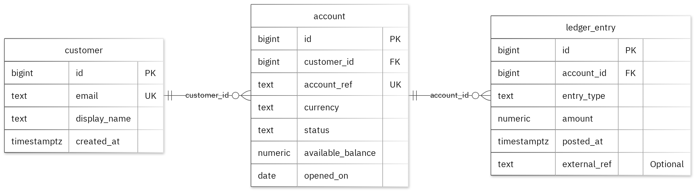

# MIT 8103 Advanced Database Systems

**Diamond Digital Bank** · Akhere Iria · Student ID 301932490

## Case study

My case study is Diamond Digital Bank. I designed the database for fintech operations analysts and database students, with separate tables named customer, account and ledger_entry. It supports these operations: open an account for a customer; post a positive debit or credit entry to an account; review account activity and balances; compare ledger date-filter plans with and without a B-tree index.

## Portfolio 1: Database Design and Modelling

I organised the relational design into 3 tables. Primary keys identify records, foreign keys preserve the links, and checks enforce the stated business rules. When external_ref is non-null, it must be unique among ledger entries; multiple entries may have no external reference. The normalisation examples show the sample data at 1NF, 2NF and 3NF. All 11 deliberately invalid inserts were rejected without changing the valid sample rows.

Figure 1. Tables, keys and relationships. PK: primary key; FK: foreign key; UK: unique value.

<!-- PAGE BREAK -->

## Portfolio 2: Query Processing and Optimisation

I ran three SQL queries against the sample records. The join returned 2 rows and included ava.chen@example.test with ACCT-SYN-001. For the index comparison, I used 50,000 separate performance rows. The median lookup time changed from 2.244 ms to 0.275 ms. Both phases returned the same records. The measured plan used the new index. These timings apply to this lookup and environment.

## Portfolio 3: Transactions and Concurrency

I used a temporary counter on account to test COMMIT, ROLLBACK and READ COMMITTED isolation. The uncommitted update remained hidden from the other session, and ROLLBACK restored the earlier committed value. Without locking, two increments left the counter at 2. With SELECT FOR UPDATE, Session B waited for Session A and the final value was 3. The helper is confined to this exercise; the case's original business fields stay unchanged.

## Portfolio 4: NoSQL and Advanced Data Models

I used account_event_stream for the case's event documents. MongoDB inserted 4 sample events and returned the expected results for 4 queries. Validation rejected an invalid date type and a duplicate event ID. Embedded snapshots keep related details with an event, while the details field can differ by event type. These are fictional events; PostgreSQL continues to enforce its relational rules.

## Repository and evidence

https://github.com/akhereiria/Iria_Akhere_301932490

The portfolio folders contain the SQL and JavaScript, explanations, query plans, result tables and screenshots.

<!-- PAGE BREAK -->

## Portfolio 5: Distributed and Cloud Database Exercise

I proposed a three-member MongoDB replica set distributed across separate failure zones to enhance availability and resilience. The discussion covered primary elections, majority acknowledgements, secondary replication lag, and the trade-offs associated with sharding for the account_event_stream. It also highlighted that replication supports high availability, while backups provide a separate layer of data recovery. PostgreSQL would require an independent high-availability strategy. This was limited to the permitted discussion scope; no live replica set was deployed, and no failover testing was conducted.

## Individual reflection

I kept customer, account, ledger_entry in separate tables so their details could be maintained without repeating them in every related record. When external_ref is non-null, it must be unique among ledger entries; multiple entries may have no external reference. The constraint tests check this alongside the required values and record links. One issue illustrated by the two-session exercise is that both sessions can read the same value before either update is committed. Locking the row before reading preserves both increments. The index comparison also shows why I need to check the execution plan as well as the final answer: the same result can require different amounts of database work.

## AI-use declaration

I used the portfolio generator and GitHub Copilot to help prepare the database model, scripts and explanations. The generator ran the PostgreSQL and MongoDB exercises. I checked and verified their outputs and captured the result images. 

## References

- [PostgreSQL: constraints](https://www.postgresql.org/docs/17/ddl-constraints.html)
- [PostgreSQL: EXPLAIN](https://www.postgresql.org/docs/17/using-explain.html)
- [PostgreSQL: isolation](https://www.postgresql.org/docs/17/transaction-iso.html)
- [PostgreSQL: row locks](https://www.postgresql.org/docs/17/explicit-locking.html)
- [MongoDB: data modelling](https://www.mongodb.com/docs/manual/data-modeling/)
- [MongoDB: replication](https://www.mongodb.com/docs/manual/replication/)
- [MongoDB: sharding](https://www.mongodb.com/docs/manual/sharding/)
- [Mermaid: ER diagrams](https://mermaid.js.org/syntax/entityRelationshipDiagram.html)
